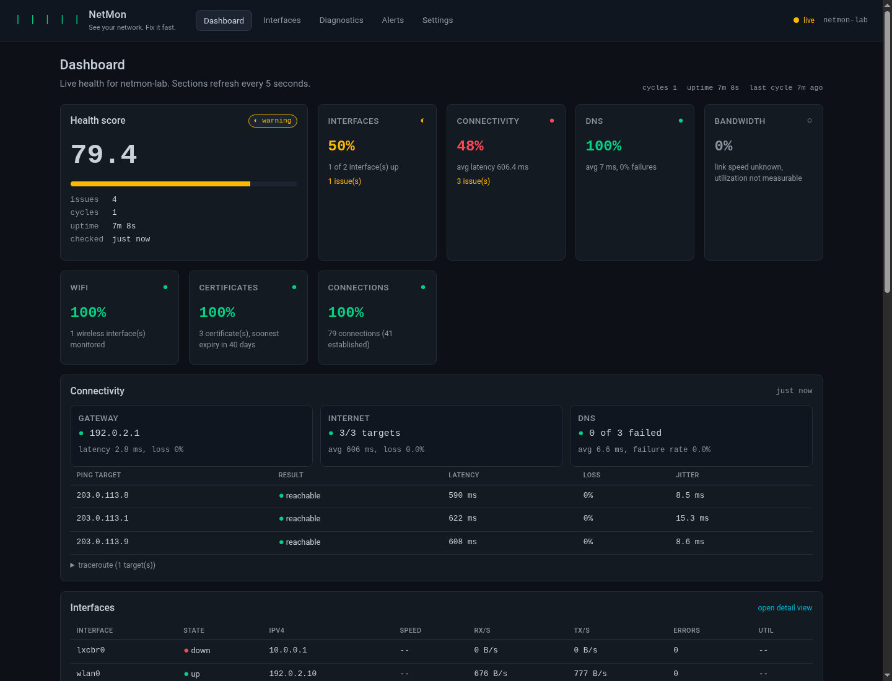
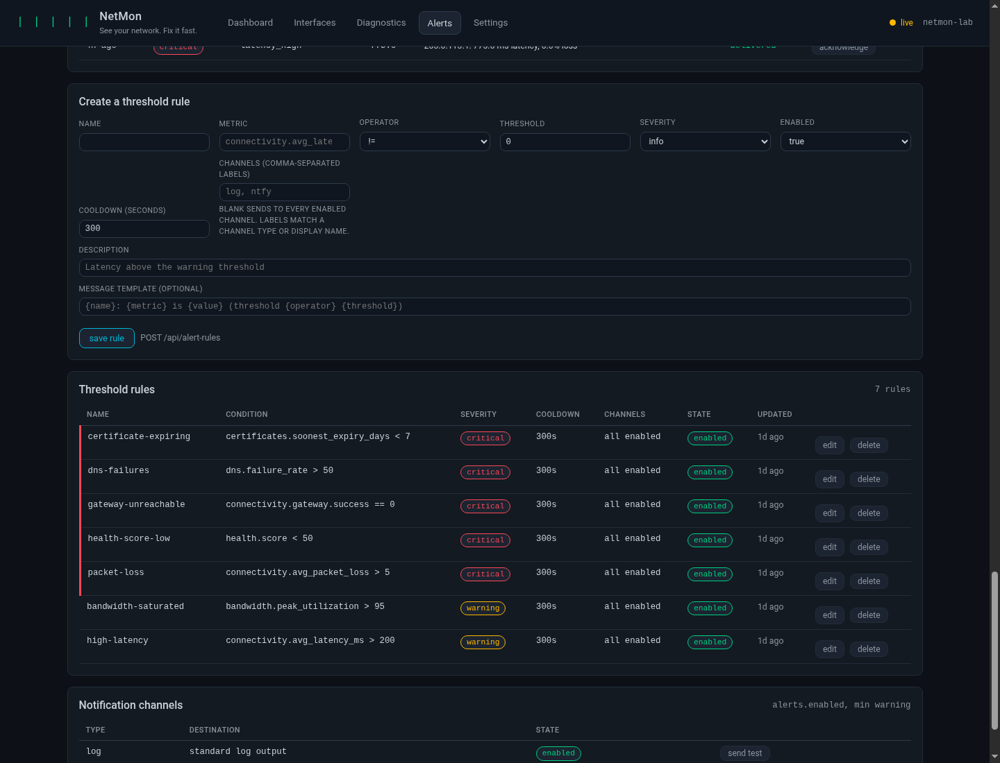

# NetMon

[](https://github.com/insomniasdream666/netmon/actions/workflows/ci.yml)

**See your network. Fix it fast.**

NetMon is a real-time network monitor and diagnostic assistant for Kali Linux.
Seven collectors stream interface, connectivity, bandwidth, port, connection,
Wi-Fi and TLS-certificate state into a health-scored model; a deterministic
rule engine handles known faults instantly, and a local Ollama model diagnoses
everything else with structured, evidence-backed remediation steps.

NetMon **never executes a fix silently** — every command is shown to you first
and requires an explicit confirmation.

```
████ ████ ████ ████ ████   NetMon
████ ████ ████ ████        See your network. Fix it fast.
████ ████ ████
████ ████
████
```

## Features

- **7 async collectors** — interfaces, connectivity (ping/DNS/traceroute/gateway),
  bandwidth, ports (nmap), connections (`ss`), Wi-Fi (`iw`), certificates (TLS).
  Each runs on its own schedule with error isolation: one failing collector
  never stalls the others.
- **Health scoring** — per-component scores (interfaces, connectivity, DNS,
  bandwidth, Wi-Fi, certificates, connections) rolled into one weighted 0-100
  score with `ok` / `warning` / `critical` states.
- **Alerting** — default threshold rules plus issue-derived alerts, cooldown
  suppression, SQLite-persisted event history and log/ntfy/webhook/discord
  channels, with a browser rule editor, per-rule channel routing and
  per-channel test buttons.
- **Rule + AI diagnostics** — 17 deterministic rules cover the common faults;
  anything else goes to a local Ollama model with a strict JSON output contract
  (`diagnosis`, `confidence`, `fixes`, `risks`, `verify`). AI failures always
  degrade to the rule verdict, never to silence.
- **Diagnostic history & learning** — every diagnosis and fix outcome is stored
  in SQLite; successful past fixes are fed back into future prompts. Each
  history entry opens its full recorded diagnosis.
- **Textual TUI** — dark `#0D1117` theme, live health card, braille metric
  graphs, interface/connection tables, diagnostics and alerts screens.
- **Web dashboard** — FastAPI + HTMX with REST API, WebSocket live updates,
  SSE alert streaming, clickable diagnostics history, an alert-rule/event
  manager and a typed Settings page that applies changes live. Optional HTTP
  Basic authentication protects pages, APIs and streams. HTMX and Chart.js are
  vendored locally, so the dashboard works offline.
- **Two storage layers** — SQLite for config/state/history, InfluxDB for
  time-series metrics (with an in-memory ring-buffer fallback so NetMon keeps
  working when InfluxDB is down).

## Screenshots

The dashboard is dark-first by design and works without external CDNs:



The alerts page combines event history, per-rule channel routing and
per-channel tests:



## Requirements

- Kali Linux (or any recent Debian-based distro), Python 3.11+
- Network tools: `ip`, `ping`, `ss`, `iw`, `nmap`, `openssl`,
  `journalctl`, optionally `traceroute`/`tracepath` and `dig`
- Optional: InfluxDB 2.x for metric history, Ollama for AI diagnostics

```bash
sudo apt update && sudo apt install -y iproute2 iputils-ping iw nmap openssl traceroute dnsutils
```

## Installation

```bash
git clone https://github.com/insomniasdream666/netmon.git
cd netmon
pip install -e ".[dev]"        # or: pip install -e .
```

On Kali/Debian with an externally managed Python (PEP 668), install into your
user site instead — it never touches the distro Python:

```bash
pip install --user --break-system-packages -e ".[dev]"
```

This installs the `netmon` entry point. Verify the environment with:

```bash
netmon doctor
```

For an automated install (virtual environment, optional systemd unit and a
starter configuration), use `./scripts/install.sh --user` or
`sudo ./scripts/install.sh`. `./scripts/dev-setup.sh --venv` prepares a
development environment. See [docs/usage.md](docs/usage.md) for all options.

## Quick start

```bash
# Launch the interactive TUI (default)
netmon

# Serve the web dashboard instead
netmon --web --host 127.0.0.1 --port 8080

# Run as a daemon with no interface
netmon --headless

# One-shot commands
netmon status                     # collect once, print the health summary
netmon diagnose                   # diagnose the most severe current issue
netmon diagnose gateway_unreachable --no-ai
netmon scan 127.0.0.1             # nmap wrapper with the configured port set
netmon config show                # effective configuration
netmon config set web.port 9090   # persist a single value
netmon service install            # systemd unit (user or system scope)
```

## Configuration

NetMon resolves configuration in this order: **environment variables beat
`config.yaml`, which beats built-in defaults**. A `.env` file is loaded as
well (`NETMON_ENV_FILE`, then `./.env`, then `~/.config/netmon/.env`); real
environment variables always win over it. The YAML file lives at
`~/.config/netmon/config.yaml` unless `NETMON_CONFIG_PATH` says otherwise.
Any setting can be overridden with `NETMON_*` and `__` nesting, for example
`NETMON_WEB__PORT=9090` or `NETMON_MONITORING__INTERVALS__WIFI=60`.

```bash
cp .env.example .env    # every important knob is documented there
```

Key settings:

| Setting | Default | Meaning |
|---|---|---|
| `monitoring.intervals.*` | 2-3600s | Per-collector polling cadence |
| `monitoring.targets.ping` | `8.8.8.8`, `1.1.1.1`, `9.9.9.9` | ICMP targets |
| `monitoring.targets.dns` | `google.com`, ... | DNS lookup probes |
| `monitoring.port_scan.targets` | `127.0.0.1` | nmap targets |
| `monitoring.ignored_interfaces` | `lo`, `docker0`, ... | Interfaces excluded from health |
| `health.thresholds.*` | see docs | Warning/critical thresholds |
| `alerts.cooldown` | `300` | Seconds between duplicate alerts |
| `ollama.model` | `llama3:8b` | Local model for AI diagnostics |
| `web.port` | `8080` | Web dashboard port |
| `web.auth` | `false` | Require HTTP Basic authentication |
| `storage.retention.diagnostics` | `90` | Days of diagnostic history kept |

The InfluxDB token is **environment-only** (`INFLUXDB_TOKEN`): it is stripped
from `config.yaml` on save and cannot be set through the API. Web auth
credentials are environment-only too (`NETMON_WEB_USERNAME`,
`NETMON_WEB_PASSWORD`).

Full reference, metric schema and troubleshooting: **[docs/usage.md](docs/usage.md)**.

## InfluxDB (optional but recommended)

```bash
cd docker
export INFLUX_TOKEN="$(openssl rand -hex 24)"
export INFLUXDB_PASSWORD="$(openssl rand -hex 16)"
docker compose up -d influxdb
```

Then export the same token for NetMon
(`export INFLUXDB_TOKEN="$INFLUX_TOKEN"`) and check it with `netmon doctor`.
Without a token NetMon silently degrades to in-memory metrics — nothing else
changes.

## Ollama (AI diagnostics)

```bash
# Install from https://ollama.com, then:
ollama serve
ollama pull llama3:8b        # or any small instruct model you prefer
```

`netmon doctor` reports whether the server is reachable and the model is
present. `--no-ai` (or `netmon config set ollama.enabled false`) restricts
diagnosis to the deterministic rule engine.

## Web API

| Endpoint | Method | Purpose |
|---|---|---|
| `/api/health` | GET | Overall health plus component scores |
| `/api/interfaces` | GET | All interfaces with current metrics |
| `/api/interfaces/{name}` | GET | One interface plus history |
| `/api/connectivity` | GET | Current connectivity status |
| `/api/collectors` | GET | Collector and scheduler status |
| `/api/metrics/{measurement}` | GET | Time series (`?range=1h&interval=10s`) |
| `/api/diagnose` | POST | Diagnose an issue (`{"issue_key": ...}`) |
| `/api/fix` | POST | Execute a fix (`{"diagnosis_id": ..., "fix_index": 0, "confirm": true}`) |
| `/api/diagnostics/history` | GET | Recorded diagnoses, newest first |
| `/api/diagnostics/{id}` | GET | One recorded diagnosis |
| `/api/config`, `/api/config/{key}` | GET/PATCH | Read or update configuration |
| `/api/alerts`, `/api/alerts/{id}/acknowledge` | GET/POST | Alert history and acknowledgement |
| `/api/alert-channels/{index}/test` | POST | Send a test alert to one channel |
| `/api/alert-rules`, `/api/alert-rules/{name}` | GET/POST/PUT/DELETE | Threshold rules |
| `/ws/live` | WS | Live state stream |
| `/sse/alerts` | SSE | Alert notifications |

The web interface also provides `/alerts` (events, rule editor and channel
tests) and `/settings` (every effective setting, validated and applied live).
Every diagnostics history entry links to its full record at
`/diagnostics/history/{id}`. The complete endpoint reference is in
[docs/usage.md](docs/usage.md#4-web-dashboard-and-http-api).

When `web.auth` is enabled, every page, REST call, WebSocket and SSE stream
requires HTTP Basic credentials. `/api/health` stays available to loopback
health probes and `/static/` remains public, so container health checks and
offline assets keep working. Set the credentials in the environment and enable
auth in config:

```bash
export NETMON_WEB_USERNAME=admin
export NETMON_WEB_PASSWORD='use-a-long-random-password'
netmon config set web.auth true
```

Basic auth does not encrypt traffic. Bind to `127.0.0.1` or terminate TLS at an
authenticating reverse proxy before exposing the dashboard to a network.

## Development

```bash
python -m pytest tests/unit -q          # fast unit suite
python -m pytest tests/integration -q   # end-to-end pipeline tests
ruff check .                            # lint
mypy netmon/                            # types
```

The collector data contract (authoritative schemas consumed by the health
checker, TUI and web API) is documented in
[docs/COLLECTOR_CONTRACT.md](docs/COLLECTOR_CONTRACT.md).

## Safety model

- Fixes are **never auto-executed**. `execute_fix()` refuses to run unless the
  caller passes `confirmed=True`, which only ever happens after a human reads
  the exact command in the TUI/web UI.
- Commands matching destructive patterns (`rm -rf /`, `mkfs`, `dd if=`, ...)
  are flagged as dangerous and clearly marked in every interface.
- Collectors invoke external tools without a shell, with hard timeouts, so a
  hung `openssl` or `nmap` can never pin the monitoring loop.
  User-confirmed fixes may use a shell for pipelines (for example
  `openssl s_client ... | openssl x509`) and are also hard-time-limited.
- AI output is validated: malformed JSON, extra prose or hallucinated fields
  degrade gracefully to the rule engine's verdict.

## License

MIT
